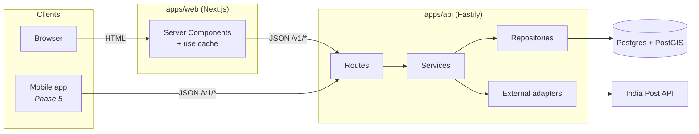
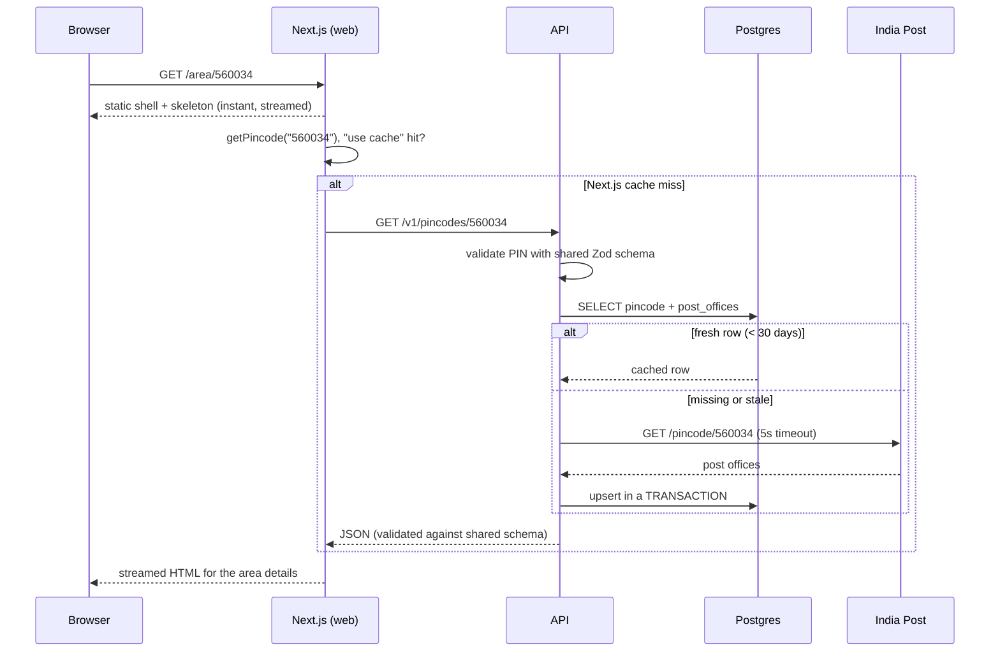
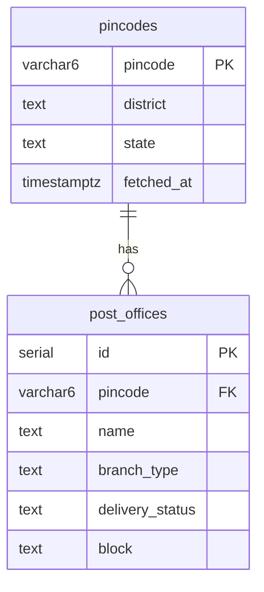
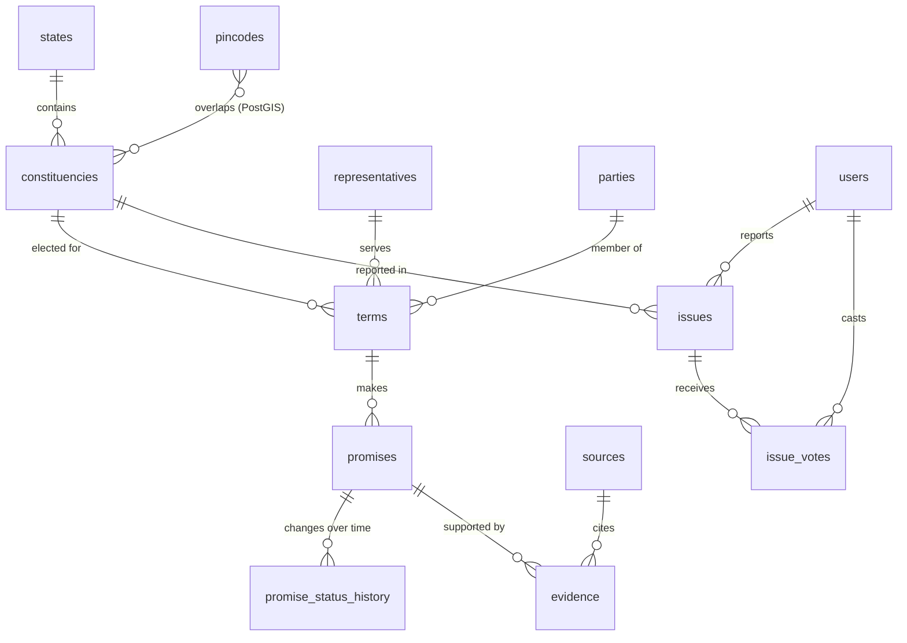

# TrackBharat: Architecture & Learning Guide

> **Mission:** make political promises measurable and government performance understandable to ordinary citizens.
>
> This document explains **how the system is built and why**. Read it top to bottom once, then use it as a
> map while reading the code. Every important decision has a longer write-up in [`docs/adr/`](./adr).

**Contents**
1. [The big picture](#1-the-big-picture)
2. [Repository layout](#2-repository-layout)
3. [Life of a request](#3-life-of-a-request)
4. [The API: layered architecture](#4-the-api-layered-architecture)
5. [The database](#5-the-database)
6. [The web app: rendering model](#6-the-web-app-rendering-model)
7. [Data sources & the PIN → constituency problem](#7-data-sources--the-pin--constituency-problem)
8. [Security, trust & neutrality](#8-security-trust--neutrality)
9. [DevOps: local, CI, Docker, deploy](#9-devops-local-ci-docker-deploy)
10. [Testing strategy](#10-testing-strategy)
11. [Roadmap](#11-roadmap)
12. [Study guide: Phase 0](#12-study-guide-phase-0)
13. [Glossary](#13-glossary)

---

## 1. The big picture



There are three deployable pieces:

| Piece | Tech | Responsibility |
|---|---|---|
| **web** | Next.js 16 (App Router, React 19, Tailwind v4) | Renders pages on the server for speed + SEO. Holds **no** business logic and **no** DB access. |
| **api** | Fastify 5 + TypeScript | The **only** thing that talks to the database and to external data sources. One API serves web *and* mobile. |
| **db** | Postgres 17 + PostGIS | The source of truth. Schema lives in git as SQL migrations. |

Plus one library, **`packages/shared`**: Zod schemas describing every request/response. It is the *contract*
between api, web and (later) mobile.

### Why not "Next.js talks straight to the database"?
That works for a website, but TrackBharat will have a **mobile app**. Mobile apps can't import your
server code; they need an HTTP API. Building the API first means the mobile app is "just another client" later,
with no rewrite. See [ADR-0002](./adr/0002-own-api-instead-of-supabase.md).

---

## 2. Repository layout

```
trackbharat/
├─ apps/
│  ├─ api/                     Fastify REST API
│  │  ├─ src/
│  │  │  ├─ server.ts          entry point: wires real dependencies, starts listening
│  │  │  ├─ app.ts             app factory: plugins, error handler, routes (no I/O)
│  │  │  ├─ config.ts          env vars → validated, typed config
│  │  │  ├─ lib/errors.ts      AppError: typed, expected errors
│  │  │  ├─ db/                schema.ts, client.ts, migrate.ts, seed.ts
│  │  │  └─ modules/<feature>/ routes → service → repository (+ external clients)
│  │  ├─ drizzle/              ✅ committed SQL migrations (the database's history)
│  │  ├─ test/                 vitest tests
│  │  └─ Dockerfile
│  └─ web/                     Next.js app
│     ├─ src/app/              routes (folder = URL): /, /area/[pincode], /rights, ...
│     ├─ src/components/       UI components (ui/ = primitives)
│     ├─ src/lib/api.ts        typed, cached API client (server-only)
│     └─ Dockerfile
├─ packages/shared/            Zod schemas = API contract
├─ docs/                       this file + ADRs
├─ docker-compose.yml          local Postgres (+ full stack with --profile full)
├─ .github/workflows/ci.yml    CI pipeline
└─ pnpm-workspace.yaml         monorepo definition
```

**Monorepo** = several apps in one git repo. Benefits: one PR can change the API *and* the web page that uses it;
the shared contract is imported directly instead of being published to npm. Tool: **pnpm workspaces**
(`"@trackbharat/shared": "workspace:*"` means "use the local folder"). See [ADR-0001](./adr/0001-monorepo-with-pnpm-workspaces.md).

---

## 3. Life of a request

What happens when someone opens **`/area/560034`**:



Notice there are **three layers of caching**, each with a different job:

| Layer | Where | Lifetime | Purpose |
|---|---|---|---|
| Postgres `pincodes` table | API | 30 days (`PINCODE_CACHE_TTL_DAYS`) | Don't depend on India Post being up; be fast. |
| `"use cache"` + `cacheLife("hours")` | web server | hours | 1,000 visitors → 1 API call. |
| `Cache-Control` header | browsers / CDN | 1 hour | Repeat visits don't even reach our servers. |

---

## 4. The API: layered architecture

Each feature is a folder in `apps/api/src/modules/` with the same layers:

```
routes      HTTP only: parse & validate input, call service, set headers.        pincode.routes.ts
  ↓
service     Business rules. No HTTP, no SQL. Pure, testable logic.               pincode.service.ts
  ↓                ↘
repository   SQL via Drizzle. The only code that knows table names.               pincode.repository.ts
external client   Adapter for a 3rd-party API; translates their format to ours.   india-post.client.ts
```

**Why layers?** Each layer can change without touching the others. Swap India Post for another
data source → only the client changes. Add a CLI or a cron job that looks up PINs → it calls the service;
routes aren't involved.

### Dependency injection (DI)
Services don't `import` the database. They **receive** it:

```ts
createPincodeService({ repo, directory, cacheTtlDays, now })
```

`server.ts` (the *composition root*) passes real implementations. Tests pass fakes. That's why
`pincode.service.test.ts` can test "India Post is down → serve stale data" in 1 ms without a network.

### Conventions
- **Versioned URLs**: `/v1/...`. A breaking change becomes `/v2`; old mobile apps keep working on `/v1`.
- **One error shape** everywhere: `{ "error": { "code", "message", "requestId" } }` (`ApiErrorBody` in shared).
  Expected errors are `AppError`s; anything else is a bug → logged with stack trace, client sees a generic 500.
- **Request IDs**: every request gets a UUID, present in every log line and every error response.
- **Config is validated at startup** (`config.ts`): a missing `DATABASE_URL` crashes immediately with a clear message.
- **Graceful shutdown**: on `SIGTERM` (sent on every deploy) we finish in-flight requests, close DB connections, then exit.
- **Security plugins**: `helmet` (security headers), `cors` (only our web origin), `rate-limit` (120 req/min/IP).

---

## 5. The database

### Do we need SQL? (and what about localStorage?)
Yes. TrackBharat's data is **relational**: a state *has many* constituencies, a constituency *has many*
representatives over time, a representative *makes many* promises, a promise *has many* evidence items, a user
*casts many* votes. SQL gives us joins, **constraints the database enforces for us** (a vote must reference a real
issue; one vote per user per issue per week), transactions, and aggregation (`GROUP BY` for scores).

| Storage | Used for |
|---|---|
| **Postgres** (server) | All real data. The single source of truth. |
| **PostGIS** (Postgres extension) | Geography: constituency boundaries, "which constituency contains this point?" |
| **Browser `localStorage`** | Tiny per-device preferences only (theme). Never real data: it's per-browser, easily wiped, and invisible to other users. |
| **SQLite on the phone** (Phase 5) | Offline cache in the mobile app. |

### Tooling: Drizzle ORM
The schema is written in TypeScript (`apps/api/src/db/schema.ts`) and **drizzle-kit generates plain SQL
migration files** that are committed. You always see the exact SQL. Read `apps/api/drizzle/*.sql`.

```bash
# change schema.ts, then:
pnpm db:generate   # writes drizzle/000N_name.sql: READ IT
pnpm db:migrate    # applies pending migrations (tracked in drizzle.__drizzle_migrations)
pnpm db:studio     # browse the data in a web UI
```

> **The lesson from v1:** the old Supabase tables were created by clicking in a dashboard. When the project was
> deleted, the schema was gone. **Schema in git as migrations** means any machine can rebuild the database from zero.

### Current schema (Phase 0)


### Planned schema (Phases 1–2)


Design choices to notice when we build it:
- `kind` on constituencies: `LOK_SABHA` (MP) vs `VIDHAN_SABHA` (MLA); boundaries stored as `geometry(MultiPolygon, 4326)`.
- `terms` separates *the person* from *the seat for a period*, which enables "compare with the previous MP".
- `promise_status_history` is **append-only**: we never overwrite a status, we add a row. That's an audit trail.
- `issue_votes` has a `UNIQUE (user_id, issue_id, week_start)` constraint, so the *database* blocks double voting.
- Weekly highlights come from a scheduled job that writes `weekly_issue_rankings`; pages read the precomputed table.

---

## 6. The web app: rendering model

Next.js 16 with **Cache Components** (`cacheComponents: true`). The rules:

1. **Server Components by default.** Pages are React components that run on the server and send HTML. No JS is
   shipped for them. Search engines and WhatsApp previews see real content (the main reason we moved off Vite).
2. **`"use client"` only where needed**: state, event handlers, browser APIs. In this codebase:
   `pincode-search.tsx`, `theme.tsx`, `rights-browser.tsx`, `contact-form.tsx`. Everything else is server-only.
3. **Static shell + streaming.** At build time Next prerenders everything it can. Anything that depends on the request
   (like `params` in `/area/[pincode]`) is awaited **inside `<Suspense>`**; the user instantly sees the shell and skeleton,
   and the data streams in. The build output shows `◐ /area/[pincode]` = *Partial Prerender*.
4. **`"use cache"`** marks a function's result as cacheable across requests (`lib/api.ts`), with `cacheLife` for
   duration and `cacheTag` for targeted invalidation later (`revalidateTag("pincode:560034")`).
5. **`server-only`**: `lib/api.ts` imports it, so the build fails if a client component ever imports the API client
   (which would leak the internal `API_URL`).

> **Known trade-off:** with streaming, the HTTP status (200) is sent before we know the PIN doesn't exist, so an
> unknown PIN shows the 404 page with status 200. Next.js marks it `noindex` for search engines. Acceptable here.

### Design system
All colours are CSS variables in `src/app/globals.css` (light + `.dark`), exposed to Tailwind as `bg-surface`,
`text-muted`, `text-saffron`, etc. Components never hard-code colours. UI primitives (`components/ui/`) are
hand-written and small, so there's no UI kit to fight.

---

## 7. Data sources & the PIN → constituency problem

A PIN code is a **postal** zone; a constituency is an **electoral** zone. They were drawn by different
departments and **don't line up**: one PIN can span two constituencies.

**Plan (Phase 1):**
1. Load constituency **boundary polygons** (post-2008 delimitation, from public GIS datasets) into PostGIS.
2. Geocode each PIN to a point/area (post office locations).
3. `ST_Intersects(pin_area, constituency.boundary)` → 1 or more constituencies.
4. If more than one, the UI asks *"Which area are you in?"* instead of guessing.

**Data we will import** (all public; each row stores its `source_url`):

| Data | Source |
|---|---|
| PIN → post offices | India Post (live) ✅ |
| Candidates' affidavits: assets, cases, education | Election Commission of India / ADR (MyNeta) |
| MP attendance, questions, debates | Lok Sabha / PRS Legislative Research |
| Constituency development funds | MPLADS portal |
| Manifestos & promises | Party manifestos, official speeches, gazettes |

Licences differ per source; every import script will record the licence and attribute the source in the UI.

---

## 8. Security, trust & neutrality

| Concern | Measure |
|---|---|
| Secrets | Never in git. `.env` files are gitignored; `.env.example` documents every variable. Only values *designed* to be public use `NEXT_PUBLIC_`. |
| Input | Everything from outside (users, India Post) is validated with Zod before use. |
| Abuse | Rate limiting now; from Phase 2: accounts, per-user vote limits enforced by DB constraints, moderation queue, audit log. |
| Errors | Internal details never reach the client; request IDs connect user reports to logs. |
| Containers | Run as non-root `node` user; minimal multi-stage images. |
| **Neutrality** | Same rules and published formula for every party. **No claim without a source link.** This also protects the project legally (defamation). |
| **Privacy** | India's **DPDP Act 2023** applies to user data: collect the minimum, explain why, allow deletion. Phase 2 will be designed around this. |

---

## 9. DevOps: local, CI, Docker, deploy

### Local development
```bash
pnpm install            # all workspaces
pnpm db:up              # Postgres+PostGIS in Docker (host port 5433)
pnpm db:migrate         # create tables
pnpm db:seed            # sample data
pnpm dev                # api :4000 + web :3000 with hot reload
```
Run the full production-like stack in containers: `docker compose --profile full up --build`.

### Docker concepts used
- **Multi-stage builds**: `deps → build → runtime`. The final image has no compilers or dev dependencies.
- **Layer caching**: `package.json` files are copied *before* the source, so `pnpm install` is skipped when only code changed.
- **Healthchecks**: compose waits for Postgres to be healthy; a one-shot `migrate` service must succeed before `api` starts.
- **Next.js standalone output**: a self-contained `server.js` with only the traced dependencies.

### CI (`.github/workflows/ci.yml`)
On every push/PR, GitHub Actions spins up a real PostGIS, then: install → lint → typecheck → test →
**apply migrations to an empty DB** → **fail if `schema.ts` changed without a migration** → build → build both
Docker images. A red ✗ blocks merging.

### Deployment (Phase 4 plan)
| Piece | Candidate | Why |
|---|---|---|
| web | Vercel | Native Next.js support, preview deploy per PR. |
| api | Render / Railway / Fly.io (Docker image) | Runs our exact container. |
| db | Neon or Supabase **as plain managed Postgres** | Managed backups; PostGIS supported. |
| errors / logs | Sentry + platform logs | Know about bugs before users report them. |

Environments: **local → staging (every merge to main) → production (tagged releases)**, each with its own database and secrets.

---

## 10. Testing strategy

The **testing pyramid**: many fast unit tests, fewer integration tests, a few end-to-end tests.

| Level | Example | Tool |
|---|---|---|
| Unit | Cache-aside rules with fakes (`pincode.service.test.ts`) | Vitest |
| HTTP / contract | `app.inject()` + parse responses with shared schemas (`app.test.ts`) | Vitest + Fastify inject |
| Schema | PIN validation (`packages/shared/src/pincode.test.ts`) | Vitest |
| Repository vs real DB | *(Phase 1)* run against the CI Postgres | Vitest |
| End-to-end | *(Phase 3)* type a PIN in a real browser | Playwright |

`pnpm test` runs all of them.

---

## 11. Roadmap

| Phase | Theme | Status |
|---|---|---|
| 0 | Foundation: monorepo, API, DB, migrations, Docker, CI, PIN lookup | ✅ Done |
| 1 | Constituencies (PostGIS), MP/MLA profiles, **promise tracker** with sources & evidence, admin data entry | Next |
| 2 | Auth & roles, citizen issue reporting, **weekly top issues** (scheduled job), moderation, audit log | |
| 3 | Report cards with a public formula, history comparison, charts, open-data export, E2E tests | |
| 4 | Deploy staging/prod, monitoring, backups, Hindi + regional languages, PWA | |
| 5 | Mobile app (Expo / React Native) on the same `/v1` API | |

---

## 12. Study guide: Phase 0

Read the code **in this order**; each file is short and commented.

1. `packages/shared/src/pincode.ts`: the contract. *Q: why does the web app import this too?*
2. `apps/api/src/config.ts`: fail-fast config.
3. `apps/api/src/db/schema.ts`, then `apps/api/drizzle/0001_pincode_cache.sql`: compare TypeScript and the generated SQL.
4. `apps/api/src/modules/pincodes/india-post.client.ts`: the adapter pattern.
5. `.../pincode.repository.ts`: transactions, upserts (`ON CONFLICT`).
6. `.../pincode.service.ts`: cache-aside + stale-if-error.
7. `.../pincode.routes.ts` → `apps/api/src/app.ts` → `server.ts`: how it's wired together.
8. `apps/api/test/*.ts`: how DI makes testing easy.
9. `apps/web/src/lib/api.ts` → `apps/web/src/app/area/[pincode]/page.tsx`: caching + Suspense.
10. `docker-compose.yml`, `apps/api/Dockerfile`, `.github/workflows/ci.yml`.

**Exercises** (do them, then delete your changes or open a PR):
- [ ] Open `pnpm db:studio`, look up a PIN on the site, watch the rows appear.
- [ ] Call `curl localhost:4000/v1/pincodes/110001` twice and compare `"source"`. Why does it change?
- [ ] Stop your internet, look up a PIN you already searched. Which code path served it?
- [ ] Add a `GET /v1/pincodes?district=Bangalore` endpoint (route → service → repository + a test).
- [ ] Add a column `circle text` to `post_offices`, run `pnpm db:generate`, read the SQL, migrate.
- [ ] Break a test on purpose, push to a branch, and watch CI go red.

**Interview questions you should now be able to answer:**
- Why a separate API instead of calling the database from Next.js?
- What's the difference between the three caches, and what does each protect against?
- What problem do migrations solve? What happens if two developers generate one at the same time?
- Why does the service receive its dependencies instead of importing them?
- What does a multi-stage Dockerfile save you?

---

## 13. Glossary

| Term | Meaning |
|---|---|
| **ADR** | Architecture Decision Record: a short note of *what* we decided, *why*, and what we gave up. |
| **Adapter** | Code that converts an external system's interface into ours. |
| **Cache-aside** | App checks the cache, on a miss loads from the source and stores it. |
| **Composition root** | The one place where real dependencies are created and wired (`server.ts`). |
| **Contract** | The agreed shape of requests/responses (`packages/shared`). |
| **Idempotent** | Running it twice has the same effect as once (migrations, seeds, upserts). |
| **Migration** | A versioned SQL file that moves the schema from version N to N+1. |
| **Partial Prerendering** | Static HTML shell served instantly + dynamic parts streamed in. |
| **PostGIS** | Postgres extension for geographic data and spatial queries. |
| **Server Component** | React component that runs only on the server; ships no JS. |
| **Stale-if-error** | If the source fails, serve the old cached copy instead of an error. |
| **Transaction** | Several SQL statements that succeed or fail together. |
